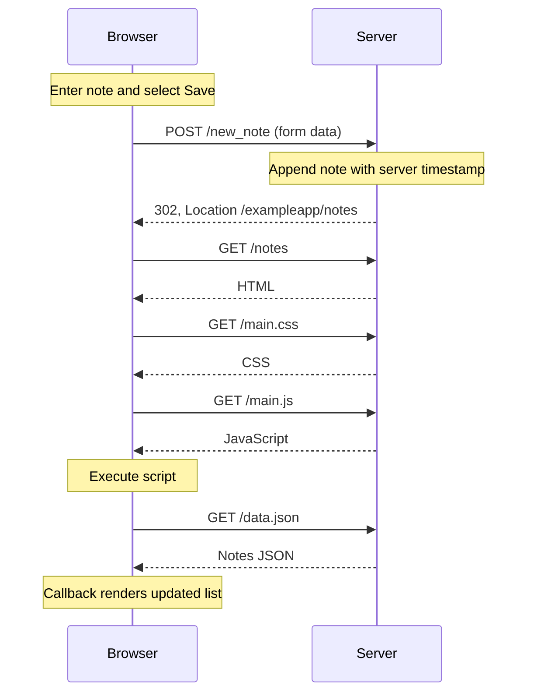
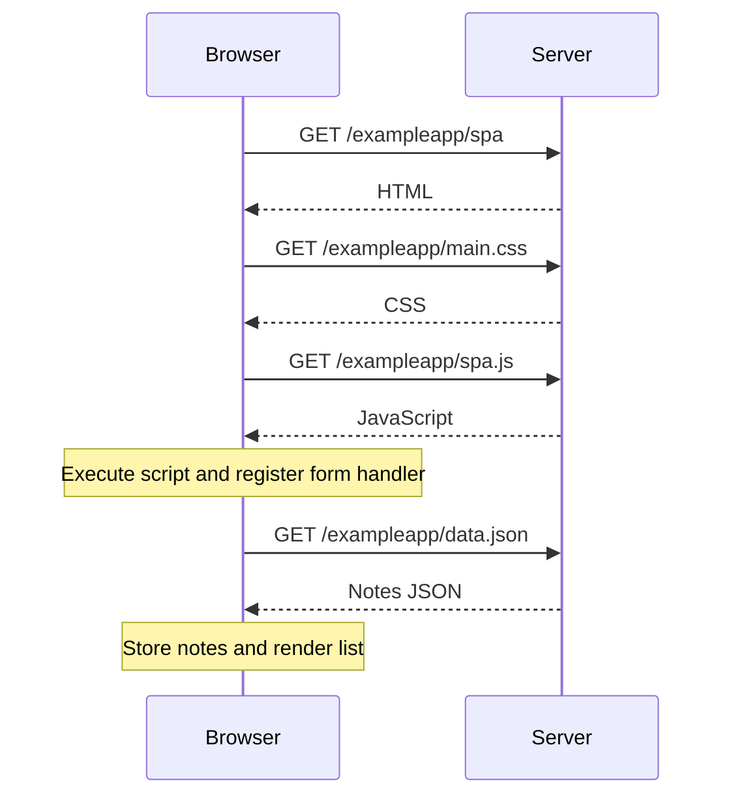
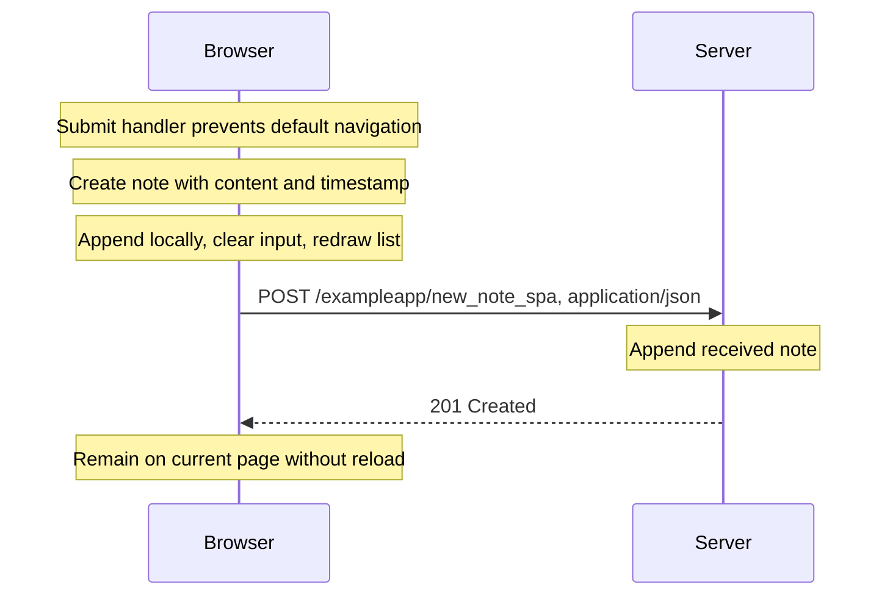

# Part 0

## 0.1–0.3: HTML, CSS, and forms

Reviewed the assigned MDN introductions to HTML structure, CSS rules and the box model, and form controls and submission.

## 0.4: Creating a note

Paths below are relative to `https://studies.cs.helsinki.fi/exampleapp`.

## 0.5: Opening the single-page app

CSS and script requests may overlap; their order does not affect the distinction between loading the document and fetching notes.

## 0.6: Creating a note in the single-page app

